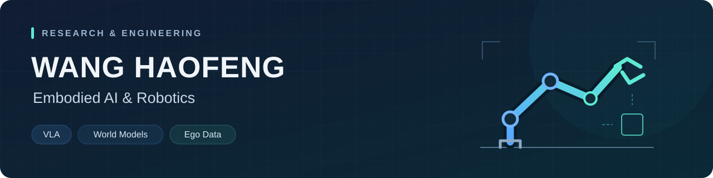

  

# 王浩峰

**北方工业大学 · 控制工程硕士研究生**

关注视觉–语言–动作模型（VLA）、世界动作模型（WAM）与具身智能体（Agent）。研究重点是操作策略的空间表征、人工纠正数据的利用，以及视频与动作的联合预训练。

**[机器人操作演示 ↗](https://wanghaofeng123.github.io/wanghaofeng123/)**

## 研究与实习经历

### 多点生活（中国）网络科技有限公司 · 具身智能算法工程师实习
2026.06–2026.10

- **VLA 空间监督**　面向商超试吃分装与递交，微调 π0.5 和 LingBot-VLA 2.0。在动作预测目标上分别引入腕部目标热力图监督和基于 VGGT 特征的 Spatial Forcing，对比目标位姿变化时的真机抓取表现。
- **交互式模仿学习**　搭建 DAgger 人工接管与分轮训练流程，按控制来源标记轨迹。对比全轨迹混合 SFT 与仅纠正片段监督，评估新旧数据采样配比对原有工况的影响。
- **世界动作模型**　适配 OpenWAM 预训练，通过屏蔽动作监督或调整动作计算路径构造两组纯视频对照，分析动作损失权重对视频生成与动作预测的影响。
- **第一视角数据**　从商超视频重建 MANO 三维手部轨迹，补全短时缺失，保留观测有效性掩码，并将轨迹与视频帧、操作描述对齐。

### 中科第五纪智能科技有限公司 · 机器人算法工程师实习
2025.07–2025.10

- **策略训练与部署**　面向抓取、摆放和开抽屉任务开展 VLA 监督微调，参与 DPO 偏好优化并完成真机部署。在已测试的固定场景中，任务成功率约为 90%。
- **感知与执行**　按时间戳对齐三路视觉、机器人状态与动作轨迹，结合 SAM 分割、深度和相机标定估计抓取位置，联调轨迹碰撞检查与关节控制接口。

**常用工具**　Python · PyTorch · OpenCV · LeRobot · ROS · Isaac Sim
