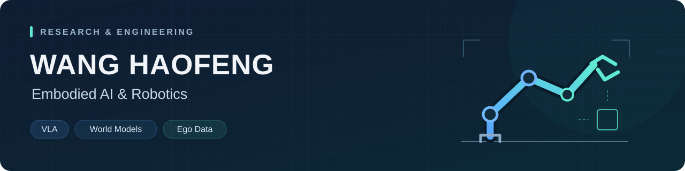

  

# 你好，我是王浩峰 👋

**北方工业大学 · 控制工程硕士**

关注**具身基础模型与智能体系统**，重点探索 **VLA、WAM 与 Agent**，以及感知、世界建模、推理与行动的协同，面向真实环境中的学习、泛化与自主决策。

**[项目演示与实验记录 ↗](https://wanghaofeng123.github.io/wanghaofeng123/)**

## 关注方向

- **具身基础模型**：VLA、WAM 等模型范式，多模态感知、世界表征与动作生成的协同。
- **世界建模与交互学习**：环境动态预测、具身表征学习，以及基于交互反馈的策略改进。
- **Agent 与自主决策**：多模态推理、任务规划、工具使用与长程任务执行。
- **学习与泛化**：模仿学习、强化学习与后训练，以及面向真实环境的迁移与泛化。

## 技术与工具

| 方向 | 技术与工具 |
| :--- | :--- |
| 编程与开发 | Python · C · MATLAB · Linux · Shell · Git |
| 模型训练与视觉 | PyTorch · TensorFlow · LoRA · OpenCV · YOLO · SAM |
| 机器人与仿真 | ROS · Gazebo · RViz · Isaac Sim · MPC · PID |
| 数据与硬件 | LeRobot · RoboTwin · MANO · STM32 · 树莓派 |

## 实习经历

**多点生活（中国）网络科技有限公司 · 具身智能算法工程师实习** 
2026.06–2026.10

参与 VLA 后训练与任务适配、世界模型预训练，以及 Ego 多模态数据处理和 MANO 手部重建。

**中科第五纪智能科技有限公司 · 机器人算法工程师实习** 
2025.07–2025.10

参与 VLA 模型微调与部署、多模态数据采集和清洗，以及机械臂运动规划器优化。

## 交流

欢迎围绕具身基础模型、VLA、WAM 与 Agent 交流。
